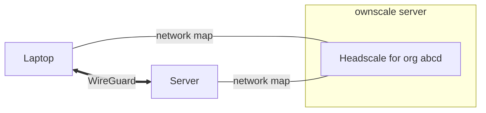

A Tailscale network has two halves: a **control plane** that decides who is
in the network and what they may reach, and a **data plane** that carries
the traffic. ownscale is the control plane. Your traffic doesn't go through
it.

## The data plane: WireGuard between machines

Every machine runs the Tailscale client, which creates an encrypted
[WireGuard](https://www.wireguard.com) tunnel to each peer it is allowed to
talk to. Connections are peer to peer: a laptop talking to a server sends
packets straight to that server, not through a central gateway. Each machine
gets a stable tailnet IP address (`100.x.y.z` and an IPv6 address in
`fd7a:115c:a1e0::/48`) that stays the same as it moves between networks.

## The control plane: the coordination server

WireGuard needs every peer's public key and current address. The
**coordination server** collects these and sends each machine a *network
map*: the list of peers, their keys and addresses, DNS settings and the
packet filter derived from the access control policy. Machines keep a
long-lived connection to the coordination server and receive updates when
something changes, such as a new machine joining or a policy edit.

Tailscale's hosted service runs its own closed-source coordination server.
[Headscale](https://headscale.net) is an open-source implementation of it,
and ownscale runs one Headscale instance per
[organization](). The URL of that instance,
`https://<org>.<BASE_DOMAIN>`, is the **login server** you pass to
`tailscale up --login-server`.

## Getting through NATs

Most machines sit behind a NAT or firewall that blocks unsolicited inbound
packets. Tailscale clients use NAT traversal: both peers send packets to each
other at the same time, using addresses learned through STUN, so each NAT
sees outgoing traffic and lets the replies in. This works in most networks.

When it doesn't, for example behind a strict corporate firewall, traffic goes
through a **DERP relay**. DERP servers relay already-encrypted WireGuard
packets over HTTPS. They can't read the traffic. By default ownscale uses
Tailscale's public DERP servers. You can
[run your own](https://tailscale.com/kb/1118/custom-derp-servers).

Run `tailscale status` or `tailscale ping <peer>` on a machine to see
whether a peer is reached directly or through a relay.

## Identity and authorization

To join a tailnet, a machine needs to be authorized by a user or an
[auth key](). With interactive
sign-in, Headscale sends the user to ownscale, which acts as the OpenID
Connect provider and in turn signs the user in with SSO, Google, Microsoft,
GitHub or a passkey. Once a machine is authorized it is owned by that user,
or by [tags]() if it was registered
with a tagged key.

Which machines can talk to each other is decided by the organization's
[access control policy]().
The coordination server compiles the policy into packet filters and sends
each machine only the rules that concern it. Each machine enforces them
locally.

## What ownscale adds

On top of Headscale, ownscale provides:

- many organizations (tailnets) on one server, each on its own subdomain;
- the web console, so no Headscale CLI or config files are needed;
- login with OIDC, Google, Microsoft, GitHub and passkeys;
- roles and invites;
- [funnels](), to publish a service
  on the internet;
- [HTTPS certificates]()
  for machine names;
- continuous backups of every database.

Tailscale's own explanation goes deeper:
[How Tailscale works](https://tailscale.com/blog/how-tailscale-works).
