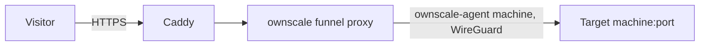

A funnel publishes an HTTP service running on a machine in your tailnet at a
public HTTPS URL. Anyone on the internet can reach it, without Tailscale.
Use it for webhooks, demos or sharing a development server.


A funnel exposes the target port to the **entire internet**. Only create
one for a service that is meant to be public and does its own
authentication if it needs any.



Funnels are experimental and will change. They are ownscale's own feature
and are created in the console. Tailscale's `tailscale funnel` command
doesn't work with ownscale.


**Who can do this:** managers create and delete funnels. Members can view
them.

## Creating a funnel

On **Funnels**, click **Create funnel route** and choose:

- **Subdomain**: a label of 1 to 63 lowercase letters and digits, without
  hyphens, unique within the organization;
- **Machine** and **port**: where requests go.

The funnel's URL is:

```text
https://<label>-<org>.<CONTENT_DOMAIN>
```

For example, label `demo` in organization `abcd` on `example.com` gives
`https://demo-abcd.example.com`.

## How it works



1. Caddy terminates TLS with a wildcard certificate.
2. ownscale's funnel proxy looks up the route.
3. The request travels through the tailnet from the `ownscale-agent` machine,
   an embedded Tailscale client that ownscale adds to the organization, to
   the target machine and port.

The `ownscale-agent` user and machine appear in your lists marked as
**Internal**. Don't remove them unless you want to remove every funnel. See
the [FAQ]().

## Limits

- The target receives **plain HTTP**. TLS to the target and raw TCP aren't
  supported.
- The original `Host` header is passed through.
- Request bodies are limited to 32 MiB.
- Each organization's funnels together accept up to 100 requests per second
  (bursts of 200) and 256 concurrent requests.
- Visitors over a limit get an error page with status `413`, `429` or `503`.
  These numbers are defaults: the server administrator can change them with
  the `FUNNEL_*` settings in `example.env`.
  ownscale.net uses [lower limits]().
- If the target machine is offline or can't be reached, or the organization is
  [asleep](),
  visitors get an error page with status `502` or `503`.
- The access control policy must allow the `ownscale-agent` machine to reach
  the target port. The default allow-all policy does.
